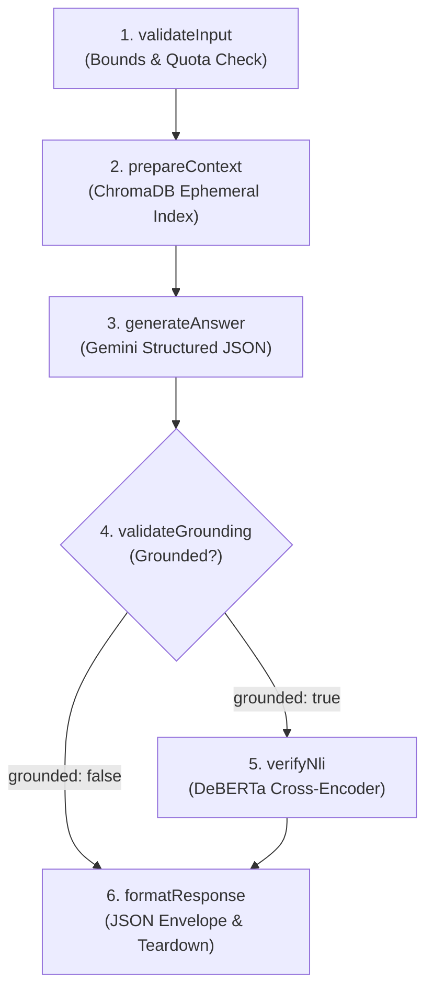

# PrismClause (ToS Red Flag Scanner) — System Architecture Specification

**Project:** PrismClause / ToS Red Flag Scanner
**Document Version:** 3.0 (Consolidated Master Architecture)
**Status:** Canonical Technical Architecture
**Audience:** System Architects, Core Developers, and Technical Evaluators

---

## 1. System Overview & Hybrid Topology

PrismClause is an AI-powered legal document intelligence platform engineered to analyze consumer Terms of Service, Privacy Policies, and Software License Agreements. The system implements a **local-first, privacy-preserving hybrid architecture** combining high-speed deterministic pattern matching with dense semantic vector search, large language model generation, and independent Natural Language Inference (NLI) cross-encoder verification.

The user interface is intentionally streamlined into a focused **Analyze** workflow supporting direct text paste, document URL scraping, and PDF file uploads, complemented by an in-situ Manifest V3 Chrome Extension.

```
┌─────────────────────────────────────────────────────────────────────────────────┐
│                                SYSTEM TOPOLOGY                                  │
└─────────────────────────────────────────────────────────────────────────────────┘

 [ Web Browser Client ]                 [ Chrome MV3 Extension ]
   ├─ Analyze Interface (HTML5/CSS3)      ├─ Active Tab DOM Inspector
   ├─ Ephemeral Session State             ├─ Document Detection & Hub Discovery
   └─ api-client.js (Bearer Auth)         └─ In-Situ Text Extractor (dom-extractor.js)
            │                                      │
            │ HTTP / REST (JSON)                   │ HTTP / REST (JSON)
            ▼                                      ▼
┌─────────────────────────────────────────────────────────────────────────────────┐
│                    NODE.JS EXPRESS API GATEWAY (127.0.0.1:3000)                 │
│                                                                                 │
│  ├─ Middleware Pipeline: Helmet CSP, CORS Whitelist, Tiered Rate Limiting       │
│  ├─ Authentication: Constant-Time Bearer Token Validator (crypto.timingSafeEqual)│
│  ├─ Document Ingestion: SSRF-Safe Cheerio Scraper, PDF Parser, Text Normalizer   │
│  ├─ Deterministic Rule Engine: 14 Canonical Risk Categories & Regex Heuristics   │
│  ├─ Readability Analyzer: Flesch Reading Ease & Flesch-Kincaid Grade Level      │
│  ├─ Dual-Engine Q&A Orchestrator:                                               │
│  │    ├─ Engine 1: Procedural 9-Stage RAG Pipeline (Production Default)         │
│  │    └─ Engine 2: LangGraph State Machine DAG (ENABLE_LANGGRAPH_QA Feature Flag)│
│  └─ Supporting Domain Engines (Headless REST APIs):                              │
│       ├─ Statutory Compliance Auditor (US, CA, EU, UK, IN Frameworks)          │
│       ├─ Contract Negotiation & Word-Level LCS Redline Differ                   │
│       ├─ Comparative Sector Benchmarking (Empirical Percentiles)                │
│       └─ Multi-Vendor Stack & Policy Drift Analyzers                            │
└───────────────────────────────────────┬─────────────────────────────────────────┘
                                        │
             ┌──────────────────────────┴──────────────────────────┐
             │ Internal HTTP Bridge (127.0.0.1:8000)                │ External HTTPS (TLS 1.3)
             │ Header: X-Internal-Token                            │ Header: x-goog-api-key
             ▼                                                     ▼
┌─────────────────────────────────────────┐             ┌─────────────────────────┐
│   PYTHON FASTAPI AI MICROSERVICE        │             │    GOOGLE GEMINI API    │
│            (127.0.0.1:8000)             │             │                         │
│                                         │             │  ├─ gemini-2.5-pro      │
│  ├─ Internal Auth: compare_digest       │             │     (Primary Explainer) │
│  ├─ Embeddings: all-MiniLM-L6-v2 (384d) │             │  ├─ gemini-3.5-flash-   │
│  ├─ Vector DB: ChromaDB EphemeralClient │             │     lite (Fallback)     │
│  │    (Document-Scoped Collections)     │             │  └─ Structured JSON Mode│
│  └─ NLI Verification Engine:            │             └─────────────────────────┘
│       cross-encoder/nli-deberta-v3-base │
│       (PyTorch CPU Classification)      │
└─────────────────────────────────────────┘
```

---

## 2. Document Ingestion Subsystem

The ingestion layer normalizes arbitrary legal agreements into standardized, segmented clauses while enforcing rigorous security boundaries.

### 2.1 Ingestion Channels
1. **Raw Text Ingestion (`backend/src/ingestion/text/text-ingest.js`):**
   - Canonical `ingestRawText(text, metadata)` entry point used across controllers and scanners.
   - Cleans invisible formatting, normalizes line endings (`\r\n` $\rightarrow$ `\n`), enforces character boundaries, and partitions text into numbered clause segments (`seg_1`, `seg_2`, ...).
2. **PDF Ingestion (`backend/src/ingestion/pdf/document-processor.js`):**
   - Receives multipart file uploads via Multer backed by `MemoryStorage` (maximum 10MB).
   - Validates magic bytes (`%PDF-`) to reject disguised malicious files before parsing.
   - Extracts page text using `pdf-parse` in memory; zero bytes are written to disk.
3. **URL Ingestion (`backend/src/ingestion/url/url-fetcher.js`):**
   - Fetches remote policies via Axios with custom User-Agent headers.
   - Enforces strict Server-Side Request Forgery (SSRF) controls blocking IPv4 loopback, private RFC-1918 subnets, link-local addresses (`169.254.169.254`), and cloud instance metadata endpoints.
   - Extracts semantic legal text using Cheerio, stripping non-content elements (`<script>`, `<style>`, `<nav>`, `<footer>`, `<header>`).
4. **Browser Extension In-Situ Extraction (`extension/content/dom-extractor.js`):**
   - Evaluates on-page DOM elements, scoring nodes based on text density and paragraph counts to isolate pure contract provisions without advertising or navigation noise.

### 2.2 Segment Normalization & Contract Format
All ingestion paths emit a uniform internal representation:
```json
{
  "id": "doc_e4b1a8f9c0",
  "text": "Full normalized contract text...",
  "segments": [
    {
      "id": "seg_1",
      "text": "1. Binding Arbitration. Any dispute arising from these terms...",
      "index": 0,
      "wordCount": 18,
      "charCount": 104
    }
  ],
  "metadata": {
    "sourceType": "text",
    "charCount": 104,
    "wordCount": 18,
    "segmentCount": 1,
    "ingestedAt": "2026-11-26T00:00:00.000Z"
  }
}
```

---

## 3. Deterministic Risk Analysis & Readability Engine

Before engaging expensive AI models, the contract is evaluated by a fast, deterministic rule engine executing in $< 50\text{ ms}$.

### 3.1 14 Canonical Risk Categories
The deterministic engine evaluates clauses across 14 high-impact consumer risk domains defined in `backend/src/analysis/risk-categories.js`:

| Category ID | Display Name | Baseline Severity | Primary Legal Risk |
| :--- | :--- | :---: | :--- |
| `ARBITRATION` | Mandatory Binding Arbitration | **HIGH** | Deprives consumer of constitutional right to jury trial. |
| `CLASS_ACTION_WAIVER` | Class Action Waiver | **HIGH** | Eliminates aggregate claims, rendering low-dollar individual disputes uneconomical. |
| `UNILATERAL_CHANGE` | Unilateral Terms Modification | **HIGH** | Permits vendor to alter terms without notice or affirmative consent. |
| `CONTENT_LICENSE` | Broad IP & Content Licensing | **HIGH** | Grants vendor perpetual, irrevocable, royalty-free sublicensing rights to user content. |
| `DATA_SHARING` | Third-Party Data Sharing & Sale | **HIGH** | Monetizes personal data and behavioral telemetries with external brokers. |
| `AUTO_RENEWAL` | Automatic Subscription Renewal | **MEDIUM** | Traps users in recurring billing cycles without affirmative renewal confirmations. |
| `LIABILITY_LIMIT` | Complete Liability Limitation | **MEDIUM** | Caps damages to nominal amounts (\$50 to \$100 or fees paid in past 12 months). |
| `TRACKING_PROFILING` | Cross-Device Tracking & Profiling | **MEDIUM** | Constructs persistent behavioral advertising profiles. |
| `JURISDICTION_VENUE` | Restrictive Foreign Venue | **MEDIUM** | Forces consumers to litigate in distant jurisdictions favoring the vendor. |
| `ACCOUNT_TERMINATION` | Unilateral Account Termination | **MEDIUM** | Allows immediate account suspension and data forfeiture without cause. |
| `INDEMNIFICATION` | Broad Consumer Indemnification | **MEDIUM** | Shifts vendor third-party legal costs and liabilities onto the user. |
| `WAIVER_OF_RIGHTS` | Statutory Rights Disclaimer | **LOW** | Disclaims implied warranties of merchantability and fitness. |
| `CONFIDENTIALITY` | Nondisclosure of Disputes | **LOW** | Gag clauses barring users from publicizing complaints or arbitration results. |
| `GOVERNING_LAW` | Restrictive Governing Law | **LOW** | Subjects agreements to vendor-favorable corporate statutory jurisdictions. |

### 3.2 Readability Scoring
`backend/src/analysis/readability/readability-scorer.js` analyzes sentence complexity and syllable counts:
- **Flesch Reading Ease Score:** Calibrated from 0 to 100 ($90\text{--}100$ very easy; $0\text{--}30$ extremely confusing legal jargon).
- **Flesch-Kincaid Grade Level:** Computes equivalent US academic schooling grade required for comprehension:
  $$\text{Grade} = 0.39 \left(\frac{\text{total words}}{\text{total sentences}}\right) + 11.8 \left(\frac{\text{total syllables}}{\text{total words}}\right) - 15.59$$

---

## 4. Dual-Engine RAG & Evidence Grounding

To guarantee factual precision and eliminate hallucinations, PrismClause orchestrates a **Dual-Engine Retrieval-Augmented Generation (RAG)** pipeline.

### 4.1 Engine 1: Procedural RAG Pipeline (Production Default)
The production pipeline executes a strictly sequential, fail-safe 9-stage lifecycle:
1. **Input Validation:** Enforces character bounds (3 to 500 characters) and caps maximum clauses at 1,000.
2. **Ephemeral Indexing:** Embeds clauses via Python `all-MiniLM-L6-v2` and indexes dense 384-d vectors into a document-scoped ChromaDB collection (`doc_<id>`).
3. **Semantic Vector Query:** Executes Top-$K$ ($K=8$) cosine similarity search against the user question.
4. **Lexical Fallback:** If vector similarity returns zero results or the AI service is unavailable, tokenizes keywords to retrieve fallback candidate clauses.
5. **Exception Clause Expansion:** Scans adjacent segments for statutory exceptions (e.g., California consumer rights or arbitration opt-out windows).
6. **LLM Generative Grounding:** Constructs a prompt bounding Google Gemini (`gemini-2.5-pro` with `gemini-3.5-flash-lite` fallback). Gemini is strictly instructed to return structured JSON grounded solely in provided clauses.
7. **Refusal Guard:** If Gemini indicates `grounded: false` or returns an unanswerable refusal, the system flags the response as ungrounded and immediately bypasses NLI to avoid false contradiction flags.
8. **Independent DeBERTa NLI Verification:** For grounded responses, sends (Premise = Clause, Hypothesis = Generated Answer) to the Python cross-encoder.
9. **Unconditional Ephemeral Teardown:** Guarantees deletion of the ChromaDB vector collection inside a `finally` block regardless of query success or error.

### 4.2 Engine 2: LangGraph State Machine DAG (Feature-Flagged)
Introduced in Phase 8B and controlled via the environment variable `ENABLE_LANGGRAPH_QA=true`, this engine replaces procedural controller logic with a formal acyclic state graph (`backend/src/rag/langgraph/`):



- **State Annotation (`QaGraphAnnotation`):** Enforces static type definitions over graph channels (`question`, `clauses`, `retrievedEvidence`, `rawAnswer`, `grounded`, `nliValidation`, `error`).
- **At-Most-Once LLM Guard:** Guarantees that Google Gemini is invoked exactly once. If downstream NLI or formatting encounters an exception, the graph fails gracefully without re-prompting the LLM.
- **Microsecond Overhead:** Empirical benchmarking demonstrates that LangGraph StateGraph compilation adds only $\approx 6.07\text{ ms}$ of overhead compared to the procedural pipeline.

---

## 5. Independent Natural Language Inference (NLI) Verification

Generative AI models are prone to subtle over-generalization. PrismClause incorporates an **independent cross-encoder** (`cross-encoder/nli-deberta-v3-base`) running locally on CPU in the Python microservice to verify that the generated answer is mathematically entailed by the retrieved contract text.

### 5.1 NLI Classification Formulation
Given a retrieved contract clause as Premise ($P$) and the generated plain-English answer as Hypothesis ($H$), the sequence classification model emits unnormalized logit scores:
$$\mathbf{z} = [z_{\text{contradiction}}, z_{\text{neutral}}, z_{\text{entailment}}]$$

The classification probabilities are computed via Softmax:
$$P(\text{class}_i) = \frac{e^{z_i}}{\sum_{j=1}^{3} e^{z_j}}$$

### 5.2 Verification Decision Matrix
- **`SUPPORTED` (Entailment):** $P(\text{entailment}) \ge 0.50$ and $P(\text{contradiction}) < 0.25$. The answer is factually proven by the clause.
- **`CONTRADICTED` (Contradiction):** $P(\text{contradiction}) \ge 0.50$. The answer asserts rights or obligations contrary to the contract text.
- **`UNCERTAIN` (Neutral / Ambiguous):** Neither condition is met, or the answer synthesizes knowledge beyond the verbatim text.

```
┌────────────────────────────────────────────────────────────┐
│                    NLI STATUS BADGES                       │
├────────────────────────────────────────────────────────────┤
│  [SUPPORTED]   Entailment >= 50%  ──► Factually Grounded   │
│  [CONTRADICT]  Contradiction >= 50% ──► Hallucination Alert│
│  [UNCERTAIN]   Neutral / Out-of-Scope ──► Unverified Claim │
└────────────────────────────────────────────────────────────┘
```

---

## 6. Supporting Headless Domain Engines (REST APIs)

While the user interface is focused strictly on the Analyze page, the backend preserves modular, production-ready headless engines available to API clients and automated workflows:

### 6.1 Statutory Regulatory Compliance Auditor (`backend/src/compliance/`)
Evaluates contract clauses against specific consumer protection statutory regimes:
- **US Federal:** FTC Act § 5 (Unfair/Deceptive Practices), Federal Arbitration Act (9 U.S.C. § 2), ROSCA Negative Option Rule.
- **California:** CCPA/CPRA, Consumer Legal Remedies Act (Cal. Civ. Code § 1750), Automatic Renewal Law (Bus. & Prof. Code § 17600).
- **European Union:** General Data Protection Regulation (GDPR Arts. 6, 7, 12, 17), Unfair Contract Terms Directive (93/13/EEC).
- **United Kingdom:** Consumer Rights Act 2015 (Schedule 2 Unfair Terms).
- **India:** Consumer Protection Act 2019 (Section 2(46) Unfair Contracts).
*Accessible via:* `POST /api/compliance/audit` and `GET /api/compliance/jurisdictions`.

### 6.2 Negotiation & Word-Level Redline Engine (`backend/src/negotiation/`)
- Computes character- and word-level token diffs using a pure dynamic programming Longest Common Subsequence (LCS) algorithm.
- Emits structured diff chunks (`insert`, `delete`, `equal`) and formatted HTML tags (`<ins>`, `<del>`).
- Assembles attorney-vetted fair counter-proposals across 3 negotiation postures (`BALANCED`, `AGGRESSIVE`, `CONSERVATIVE`) into execution-ready Contract Amendment Riders.
*Accessible via:* `POST /api/negotiation/amendment`, `POST /api/negotiation/diff`, and `POST /api/negotiation/rider`.

### 6.3 Empirical Sector Benchmarking Engine (`backend/src/benchmarks/`)
- Evaluates vendor restrictiveness against empirical datasets across 5 industry sectors (`SAAS_CLOUD`, `SOCIAL_MEDIA`, `ECOMMERCE`, `CONSUMER_APPS`, `GENERAL`).
- Emits restrictiveness percentiles ($5^{\text{th}}$ to $99^{\text{th}}$ percentile) and flags outlier provisions.
*Accessible via:* Embedded in analysis pipeline or standalone evaluation scripts.

### 6.4 Portfolio Stack & Policy Drift Engines (`backend/src/portfolio/`, `backend/src/sentinel/`)
- Multi-vendor stack risk aggregation computing systemic exposure concentrations.
- Version-over-version longitudinal policy drift diffing tracking added and stripped rights.
*Accessible via:* `POST /api/portfolio/*` and `POST /api/sentinel/*`.

---

## 7. Zero-Retention Privacy Architecture

PrismClause operates under a strict **zero permanent data retention** runtime guarantee:
1. **Volatile RAM Processing:** Raw contract text, user questions, and generated answers reside exclusively in volatile V8 and Python process heap memory.
2. **Ephemeral Vector Collections:** ChromaDB is instantiated via `chromadb.EphemeralClient()`. Collections are dynamically provisioned with unique request IDs (`doc_<uuid>`) and explicitly deleted upon query completion inside `finally` blocks.
3. **No Database Persistence:** The system operates without MongoDB, PostgreSQL, SQLite, or Redis databases. No session records or user documents are written to persistent disk storage.
4. **Audit Log Privacy Hygiene:** Operational loggers (`logger.js`) log only execution metadata (HTTP status codes, elapsed durations, character counts, NLI verdicts). Verbatim legal text, user queries, and authorization tokens are strictly redacted.
