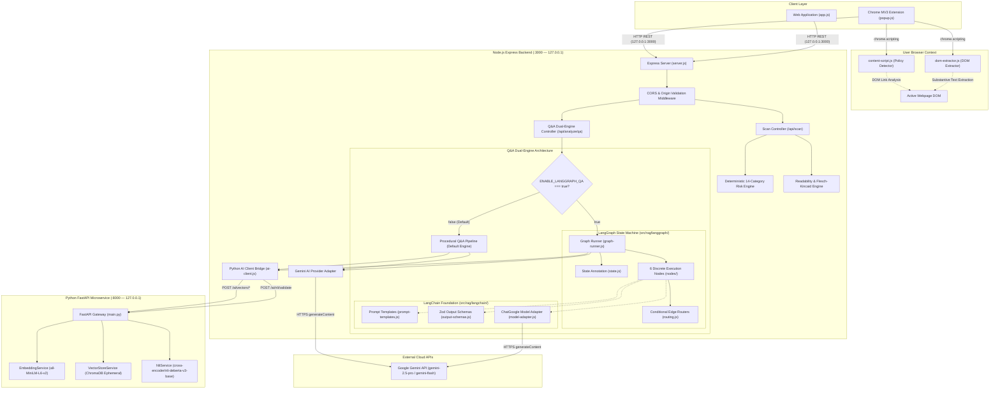
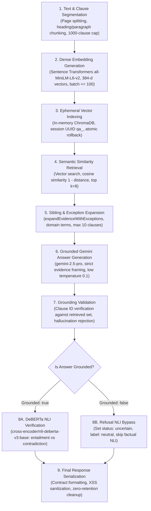
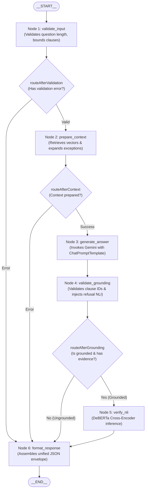

# TOS Red Flag Scanner — Technical Architecture Specification

**Authoritative Technical Reference**  
**Version:** 3.0 (Phase 8B Release — LangChain & LangGraph Integration)  
**Status:** Approved  

---

## 1. System Topology & Architectural Philosophy

TOS Red Flag Scanner implements a decoupled, local-first, privacy-preserving hybrid architecture. It bridges a modern **Manifest V3 Chrome Extension** and an **interactive Web Application** to a shared **Node.js Express 5 API Gateway** and an **isolated Python FastAPI NLP Microservice**.

In Phase 8B, the architecture was upgraded to incorporate a **modular LangChain foundation** and an **orchestrated LangGraph state machine** behind a controlled dual-engine feature flag (`ENABLE_LANGGRAPH_QA=false` by default).



---

## 2. Core Architectural Pillars

### 2.1 Zero Permanent Data Retention
- Neither user-submitted contract texts nor generated embeddings are persisted to disk.
- ChromaDB runs strictly in-memory using `chromadb.EphemeralClient()`.
- Collections are isolated by ephemeral session UUIDs (`qa_<uuid>`) and destroyed unconditionally inside `withDocumentVectors()` in a `finally` block immediately following query completion.
- LangGraph compiles without checkpointers (no `MongoDBSaver`, `SqliteSaver`, or `MemorySaver`). State exists strictly in RAM for the lifetime of `invoke()` and is immediately garbage collected.
- Audit logging records only metadata (timestamps, request IDs, character counts, finding counts); raw contract text and user questions are never written to log files.

### 2.2 Strict Multi-Document Isolation
Legal portals (such as Spotify, Google, or Apple) typically publish multiple distinct agreements (e.g., *Terms of Service*, *Paid Subscription Terms*, *Privacy Policy*, *Regional Disclosures*).
- **Candidate Keying:** Every candidate document is assigned an authoritative key:
  $$\text{Key} = \text{canonicalizeUrl}(\text{url}) + \text{"::"} + \text{normalizedCategory}$$
- **Meaningful Fragment Preservation:** In-page anchor fragments that identify distinct legal sub-documents (e.g. `#paid-subscription-terms`) are preserved by `isMeaningfulCandidateFragment()`, while layout anchors (`#top`, `#footer`, `#nav`) are stripped.
- **Independent State Registry:** `popup.js` maintains an in-memory `documentRegistry` (Map) caching extraction text, confirmation state, scan results, and Q&A history independently per candidate key.
- **Session Storage Isolation:** Q&A histories are persisted in `chrome.storage.session` using candidate-specific keys: `tos_qa_${host}_${encodeURIComponent(candidateKey)}`.
- **Asynchronous Response Routing:** In-flight Q&A requests bind their response callback to `targetCandidateKey` captured at dispatch time, completely preventing history contamination if the user switches tabs during AI processing.

### 2.3 1,000-Clause Scalability & Safe Chunking
Large consumer agreements routinely exceed 500 clauses (e.g. the Spotify Privacy Policy comprises 642 clauses).
- **Batch Chunking Boundaries:**
  - Python `EmbeddingService` limits single inference batches to 100 texts to prevent PyTorch tensor memory spikes.
  - Python `VectorStoreService` sub-batches incoming clause lists into chunks of $\le 100$.
  - Node.js `PythonAiClient` streams large clause sets to `/ai/vectors/index` in sequential batches of 400 clauses.
- **Atomic Rollback:** If any sequential chunk fails during vector indexing, Node.js immediately issues `DELETE /ai/vectors/{docId}`, ensuring partially indexed collections never corrupt semantic retrieval.
- **Oversized Document Consent:** Documents exceeding 100,000 characters require explicit user consent (`allowPartial`) before scanning, preventing silent omission of later sections.

### 2.4 Controlled Dual-Engine Architecture
The Q&A pipeline supports two interchangeable execution engines selected via the `ENABLE_LANGGRAPH_QA` environment variable:
1. **Procedural Q&A Pipeline (`false` - Active Default):** Sequential asynchronous function execution in `analyze.controller.js`.
2. **LangGraph State Machine (`true`):** Directed acyclic graph with discrete typed nodes, explicit state schema (`QaGraphAnnotation`), conditional routing, and structured Zod output validation.
- **Graceful Non-Breaking Fallback:** If LangGraph fails *before* generative answering, the controller falls back seamlessly to the procedural pipeline.
- **At-Most-Once Call Guarantee:** If LangGraph completes Gemini generation and fails on subsequent formatting, `graph-runner.js` recovers the generated answer and formats it directly, completely preventing secondary Gemini or vector calls.

---

## 3. The 9-Stage RAG Pipeline Lifecycle

The Retrieval-Augmented Generation (RAG) pipeline grounds generative answers in verbatim legal evidence through nine distinct stages:



### Detailed Stage Breakdown:

1. **Document Text and Clause Segmentation:**  
   The raw document text (from DOM extraction, PDF upload, or URL fetch) is parsed into numbered sections and clauses using `segmentDocumentPages()`. Heading hierarchies and numbered lists are preserved. Documents are capped at 1,000 clauses to protect server memory.

2. **Dense Embedding Generation:**  
   Clauses are sent to the Python microservice, where `all-MiniLM-L6-v2` encodes each clause into a 384-dimensional dense vector representation on CPU. Batches are capped at 100 items to bound tensor memory.

3. **Temporary ChromaDB Indexing:**  
   Embeddings and metadata are indexed in an in-memory ChromaDB instance (`chromadb.EphemeralClient`). Each request receives a cryptographically random, ephemeral session identifier (`qa_<uuid>`). If any indexing chunk fails, an atomic rollback deletes the session.

4. **Semantic Similarity Retrieval:**  
   The user's question is embedded into the same 384-dimensional vector space. ChromaDB executes a cosine distance search returning the top $k=8$ most relevant clauses. Cosine distance ($d$) is converted to cosine similarity:
   $$\text{similarity} = 1 - d$$

5. **Sibling and Exception Expansion:**  
   Vector search alone can miss operational nuances or exceptions located in adjacent paragraphs. `expandEvidenceWithExceptions()` inspects the top hits:
   - Identifies sibling clauses within the same section.
   - Detects exception triggers (e.g., *"except as provided in"*, *"notwithstanding"*, *"unless otherwise stated"*).
   - Injects domain-specific operational clauses for cancellation, refunds, arbitration, and privacy.
   - Deduplicates clauses and enforces a strict cap of 10 clauses.

6. **Grounded Gemini Answer Generation:**  
   The expanded evidence clauses and user question are framed inside strict delimiters. The user question is treated as untrusted input to prevent prompt injection overrides. Google Gemini (`gemini-2.5-pro` / `gemini-flash`) generates an answer with temperature $0.1$, returning:
   - `answer`: Plain-English explanation.
   - `grounded`: Boolean flag indicating whether the evidence explicitly answers the question.
   - `relevantClauseIds`: List of referenced supporting clause IDs.
   - `confidence`: Confidence score in $[0.0, 1.0]$.

7. **Grounding Validation:**  
   The backend inspects `relevantClauseIds` returned by the model and validates every ID against the actual retrieved evidence clauses. Hallucinated or non-existent clause IDs are stripped. If no valid clause IDs match and the evidence is empty, `grounded` is forced to `false`.

8. **DeBERTa NLI Verification (Phase 7G-D.6 Invariant):**  
   - **Grounded Path (`grounded: true`):** The generated answer and supporting clauses are sent to `cross-encoder/nli-deberta-v3-base`. The cross-encoder evaluates premise-hypothesis pairs, scoring entailment, contradiction, and neutrality across individual clauses and composite multi-clause premises.
   - **Refusal Path (`grounded: false`):** When evidence is insufficient, Gemini generates a refusal sentence (e.g., *"The provided Terms do not contain enough information to answer this question"*). Running factual NLI against the refusal sentence would erroneously classify it as a contradiction. Therefore, the pipeline skips NLI and directly assigns:
     `{ status: "uncertain", label: "neutral", reason: "insufficient_evidence_unanswered" }`.

9. **Final Response Serialization & Zero-Retention Cleanup:**  
   The response payload is assembled matching the unified API contract. An unconditional `finally` block issues `DELETE /ai/vectors/{qaSessionId}`, completely purging vector data from RAM.

---

## 4. LangChain Foundation (`backend/src/rag/langchain/`)

Phase 8B.1 introduced a modular LangChain foundation that standardizes prompt templates, output schema validation, and model instantiation without disturbing existing endpoints:

| Module | Source File | Core Capabilities & Exports |
| :--- | :--- | :--- |
| **Prompt Templates** | [`prompt-templates.js`](file:///d:/TOS%20red%20flag%20scanner/backend/src/rag/langchain/prompt-templates.js) | • `QA_SYSTEM_PROMPT`: Directs objective legal Q&A, evidence constraints, and refusal rules.<br>• `QA_HUMAN_PROMPT`: Frames untrusted question in triple-quotes with delimited evidence.<br>• `createQaPromptTemplate()`: Returns a reusable `ChatPromptTemplate`.<br>• `formatEvidence()`: Converts clause arrays into structured, labeled evidence blocks. |
| **Output Schemas** | [`output-schemas.js`](file:///d:/TOS%20red%20flag%20scanner/backend/src/rag/langchain/output-schemas.js) | • `qaAnswerSchema`: Zod schema validating `answer` (string), `grounded` (boolean), `confidence` (0.0–1.0), and `relevantClauseIds` (string array).<br>• `validateQaAnswer()`: Validates raw LLM JSON with informative error feedback.<br>• Replaces fragile regex parsing with standard Zod schema validation. |
| **Model Adapter** | [`model-adapter.js`](file:///d:/TOS%20red%20flag%20scanner/backend/src/rag/langchain/model-adapter.js) | • `createLangChainGoogleModel()`: Configures `@langchain/google` (`ChatGoogle`).<br>• Sets legal analysis defaults: temperature $0.1$, max output tokens $800$.<br>• `createStructuredQaModel()`: Binds model to `qaAnswerSchema` via `.withStructuredOutput()`.<br>• `isGeminiConfigured()`: Inspects API key presence with zero credential exposure. |
| **Unified Index** | [`index.js`](file:///d:/TOS%20red%20flag%20scanner/backend/src/rag/langchain/index.js) | Centralized re-exports of templates, schemas, and adapters. |

---

## 5. LangGraph State Machine (`backend/src/rag/langgraph/`)

Phase 8B.2 implemented an orchestrated state machine using `@langchain/langgraph` (v1.7.4). The state machine replaces monolithic procedural flow with discrete, typed nodes connected by directed edges and conditional routers.



### 5.1 Graph State Definition (`state.js`)
State is declared using `Annotation.Root(QaGraphAnnotation)` with 21 typed channels and a `replaceReducer`:
- **Metadata Channels:** `requestId`, `documentType`, `documentLabel`, `isPartial`.
- **Input Channels:** `question`, `rawQuestion`, `clauses`, `policyText`.
- **Evidence Channels:** `retrievedEvidence`, `hasSufficientEvidence`, `evidenceSource`.
- **Answer Channels:** `answer`, `grounded`, `confidence`, `relevantClauseIds`, `mappedEvidence`, `evidenceToValidate`.
- **Verification Channels:** `nliValidation` (status, label, scores, bestClauseId, clauseEvaluations, compositeEvaluation, reason).
- **Control Channels:** `status`, `error`, `finalResponse`.

### 5.2 Six Discrete Execution Nodes
1. **`validate_input` ([validate-input.js](file:///d:/TOS%20red%20flag%20scanner/backend/src/rag/langgraph/nodes/validate-input.js)):** Validates question length ($3 \le \text{length} \le 500$), checks clause presence, and applies the 1,000-clause boundary.
2. **`prepare_context` ([prepare-context.js](file:///d:/TOS%20red%20flag%20scanner/backend/src/rag/langgraph/nodes/prepare-context.js)):** Invokes vector search via the Python client, expands hits with `expandEvidenceWithExceptions()`, and assesses sufficiency.
3. **`generate_answer` ([generate-answer.js](file:///d:/TOS%20red%20flag%20scanner/backend/src/rag/langgraph/nodes/generate-answer.js)):** Binds prompt templates, invokes Gemini, and parses the response with `qaAnswerSchema`. If evidence is insufficient, generates an immediate refusal without calling the LLM.
4. **`validate_grounding` ([validate-grounding.js](file:///d:/TOS%20red%20flag%20scanner/backend/src/rag/langgraph/nodes/validate-grounding.js)):** Validates clause IDs against actual retrieved clauses, rejects fabricated references, and injects the Phase 7G-D.6 refusal invariant if ungrounded.
5. **`verify_nli` ([verify-nli.js](file:///d:/TOS%20red%20flag%20scanner/backend/src/rag/langgraph/nodes/verify-nli.js)):** Executes cross-encoder entailment verification on grounded answers. Skips NLI on refusals.
6. **`format_response` ([format-response.js](file:///d:/TOS%20red%20flag%20scanner/backend/src/rag/langgraph/nodes/format-response.js)):** Serializes the final response payload matching the exact API contract.

### 5.3 Conditional Edge Routing (`routing.js`)
- `routeAfterValidation`: Routes to `format_response` on invalid input; otherwise proceeds to `prepare_context`.
- `routeAfterContext`: Routes to `format_response` on context failure; otherwise proceeds to `generate_answer`.
- `routeAfterGrounding`: Routes to `verify_nli` only when `grounded === true` and evidence is present; skips to `format_response` on refusal/ungrounded answers.

---

## 6. Procedural vs. LangGraph Execution Comparison

| Architectural Dimension | Existing Procedural Pipeline | LangGraph State Machine |
| :--- | :--- | :--- |
| **Control Flow** | Monolithic linear async function in `analyze.controller.js`. | Directed Acyclic Graph (DAG) compiled with `@langchain/langgraph`. |
| **State Management** | Local variable scope (`let retrievedEvidence`, `let nliValidation`). | Formally typed State Annotation (`QaGraphAnnotation`) with channel reducers. |
| **Prompt Construction** | Procedural template string concatenation. | Reusable `ChatPromptTemplate` with system and human roles. |
| **Output Parsing** | Custom JSON parsing with fallback string checks. | Zod schema validation via `.withStructuredOutput()`. |
| **Conditional Branching** | Inline imperative `if / else` statements. | Named conditional edge router functions (`routing.js`). |
| **Testing & Mocking** | Requires mocking external HTTP requests. | Discrete node injection allows testing individual nodes in isolation. |
| **Error Shielding** | Try/catch blocks around network calls. | Dual-layer recovery: node-level catches + post-generation runner shield. |
| **Zero Retention** | Ephemeral session destroyed in `finally`. | Ephemeral session destroyed in `finally` + graph compiled without checkpointer. |
| **External API Contract** | Standard `{ success, qa: { ... } }`. | **Identical** `{ success, qa: { ... } }` (100% verified parity). |

---

## 7. Dual-Engine Control & At-Most-Once Call Guarantees

### 7.1 Feature Flag Configuration
The active engine is governed by:
```env
ENABLE_LANGGRAPH_QA=false
```
- In `backend/src/config/env.js`: `config.ai.enableLangGraphQa = process.env.ENABLE_LANGGRAPH_QA === "true"`.
- Defaults strictly to `false` (Procedural engine active).
- Requires boolean string `"true"` to enable LangGraph. All invalid/undefined values default safely to `false`.

### 7.2 At-Most-Once Invocation Matrix
To protect external API quotas and compute resources, both engines enforce strict call bounds:

| Operation | Invocation Bound | Enforcement Mechanism |
| :--- | :---: | :--- |
| **Gemini LLM Call** | $\le 1$ per request | `graph-runner.js` tracks `geminiCalled` and `geminiResult`. If LangGraph fails *after* Gemini has answered, the response is formatted from existing data. Procedural fallback is never invoked post-generation. |
| **ChromaDB Vector Index/Query** | $\le 1$ per request | Ephemeral session `qa_<uuid>` indexed and queried once per request; purged unconditionally in `finally`. |
| **DeBERTa NLI Inference** | $\le 1$ per request | Invoked at most once on grounded answers; strictly **0 times** on refusal/ungrounded answers. |

---

## 8. Security, Privacy, and Deployment Boundaries

### 8.1 Approved Localhost Scope
- **Loopback Binding:** Express binds exclusively to `127.0.0.1:3000`. Python AI binds exclusively to `127.0.0.1:8000`.
- **CORS Protection:** Rejects unauthorized web origins; restricts access to `localhost` and extension IDs (`chrome-extension://[a-p]{32}`).
- **SSRF Defense:** Blocks DNS resolution to loopback, private IPv4, and IPv6 ranges.
- **SEC-EXT-1:** Enforces `sender.id === chrome.runtime.id` and blocks tab contexts from executing privileged operations.

### 8.2 Outstanding Remote Deployment Requirements & Hardening Status
Transitioning from Localhost (Stage A) to Public Remote Cloud Deployment (Stage B) or Web Store Publication (Stage C) requires:
1. **API Authentication (SEC-BACK-1):** Completed in Phase 8C.3B via Express Bearer auth middleware (`auth.js`), controlled via `ENABLE_API_AUTH`.
2. **Tiered Rate Limiting (SEC-BACK-2):** Completed in Phase 8C.3C via `rate-limits.js`, isolating Heavy AI, Ingestion, and General routes.
3. **Configurable Extension Endpoint (SEC-EXT-2):** Completed in Phase 8C.3D via the extension Options page (`options/options.html`).
4. **Web App Authentication Compatibility:** Completed in Phase 8C.4B via centralized `api-client.js` and the Web Settings modal.
5. **HTTPS / TLS Encryption (Stage B Prerequisite):** Production Nginx/Caddy reverse proxy SSL termination with automated Let's Encrypt certificates.
6. **Containerization (Stage B Prerequisite):** Multi-stage production Docker containers for Node.js and Python microservices.

### 8.3 Internal Python AI Service Authentication (Phase 8C.3E)
Server-to-server communication between Node.js and the Python microservice is protected via an internal service token:
- **Token Configuration:** Configured via `INTERNAL_AI_SERVICE_TOKEN` in both backend and Python environments.
- **Header Injection:** Node.js `PythonAiClient` attaches `X-Internal-Token: <token>` to all protected endpoints (`/ai/embed`, `/ai/vectors/*`, `/ai/nli/*`). Public health probes (`/health`) do not require the token.
- **Constant-Time Verification:** Python `InternalTokenAuthMiddleware` verifies tokens using `secrets.compare_digest` to prevent timing attacks.
- **Zero-Downtime Rotation:** Python supports comma-separated `INTERNAL_AI_SERVICE_TOKENS` for phased secret rollover.
- **Fail-Closed Security:** When `ENABLE_INTERNAL_AUTH=true` is set, requests to protected routes fail closed with HTTP 401 if the server token is missing or invalid.
- **Localhost Compatibility:** In zero-config development when `INTERNAL_AI_SERVICE_TOKEN` is unset, the service allows local loopback calls without tokens, preserving standard developer workflows.

### 8.4 Product UI & Feature Architecture (Phase 9.3)
Phase 9.3 established a cohesive client-side SaaS view navigation architecture in `frontend/public/` without adding backend complexity or violating zero-retention privacy:
1. **View Navigation Switcher (`app.js`):** Modular client-side router (`initSaaSViews`) providing instant, flicker-free switching between 4 distinct views (`Analyze`, `Portfolio`, `Sentinel`, `Compliance`) while maintaining state in ephemeral memory.
2. **Portfolio Risk Engine Integration (`POST /api/portfolio/evaluate` & `POST /api/portfolio/compare`):**
   - In-memory `sessionVendorStack` tracking scanned vendors during browser lifetime.
   - Aggregate stack exposure score (0–100), health classification, and systemic concentration detection across vendors.
   - Head-to-head multi-vendor matrix compiler with automated procurement recommendations.
3. **Sentinel Policy Drift Engine Integration (`POST /api/sentinel/drift` & `POST /api/sentinel/snapshot`):**
   - Chronological revision comparison calculating drift direction (`MORE_RESTRICTIVE`, `MORE_FAVORABLE`, `NEUTRAL`) and magnitude score (0–100).
   - In-memory session snapshot repository (`snapshotStore`) for saving and reloading historical version text.
   - Word-level HTML redline diff generation (`computeWordDiff`).
4. **Statutory Compliance Audit Integration (`POST /api/compliance/audit` & `GET /api/compliance/jurisdictions`):**
   - Dynamic jurisdiction enumeration (US Federal, California CCPA/CPRA, EU GDPR, UK CRA 2015, India Consumer Protection Act 2019).
   - Statutory citation linking, classification (`UNENFORCEABLE_CLAUSE`, `STATUTORY_VIOLATION`), and legal guidance rendering.
5. **Strict CSP & Accessibility Standards:** Zero inline style attributes, zero inline event handlers, complete `<label for>` associations, and responsive layout scaling across desktop and mobile.

---

## 9. Comprehensive Test Suite Verification

As of Phase 9.3, the entire application test suite has been verified with a **100% pass rate**:

```text
Node.js Master Test Runner (npm test):
  Total Tests:  606
  Test Suites:  39
  Passed:       606
  Failed:       0
  Duration:     ~4.6s

Python Pytest Suite (pytest ai-service/tests):
  Total Tests:  73
  Test Files:   5
  Passed:       73
  Failed:       0
  Duration:     ~24.8s

Quantitative Academic Evaluation (scripts/evaluate.js):
  Personalized Ranking Precision@5:  99.00%  (Target: >= 85%) -> MET
  Personalized Ranking Recall@5:     99.00%  (Target: >= 85%) -> MET
  ToS Change Magnitude Macro-F1:     94.18%  (Target: >= 85%) -> MET
  User Risk Delta Macro-F1:          96.58%  (Target: >= 85%) -> MET

Combined Automated Baseline: 679 / 679 Tests Passing (100% Pass Rate)
```

The system is fully documented, tested, and aligned with academic and technical standards.